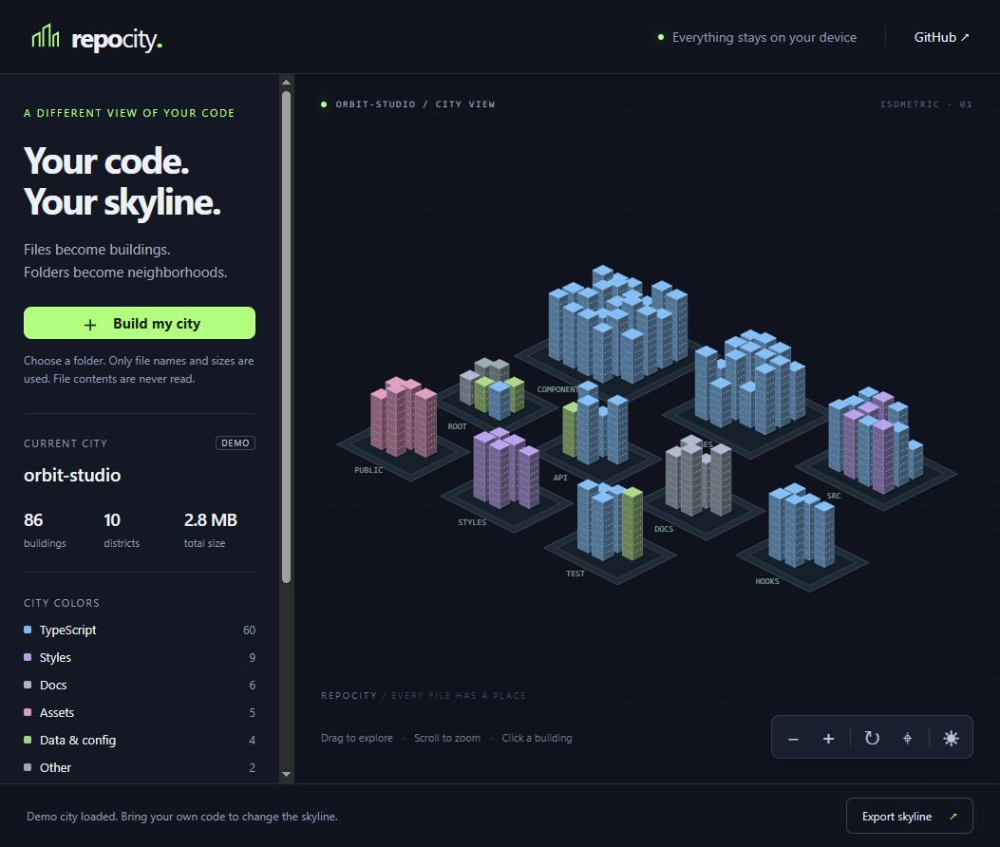

<div align="center">

# RepoCity

**Your code has a skyline.**

Files become buildings. Folders become neighborhoods.

**No uploads · No dependencies · No account · MIT**



</div>

Choose a code folder and explore it as a miniature city. Tall towers are larger files. Building colors represent file types. Each district groups files by their first folder beneath the selected project root.

## Try it

Download or clone the repository and open **index.html** in a desktop browser. There is no build step, package installation or API key. A fictional demo city appears immediately.

For a local server instead, use Node.js 20 or newer:

```sh
npm start
```

Open **http://127.0.0.1:8766**.

## Build your own city

1. Click **Build my city** and choose a project folder.
2. Drag the city to pan and use your mouse wheel to zoom.
3. Click a building to inspect its file name, path, type and size.
4. Rotate the city, switch between day and night, or reset the view.
5. Click **Export skyline** to download a PNG of the current view.

The canvas is keyboard accessible: focus it with Tab, use Left/Right to select buildings, `+`/`-` to zoom, and `0` to reset the camera. Folder selection requires a browser that supports directory inputs, such as recent Chrome, Edge or Firefox. Mobile folder pickers vary; the demo works without selecting a folder.

## How the city works

| Repository metadata | City feature |
|---|---|
| File | Building |
| First folder below the project root | District |
| File size | Logarithmic building height |
| File extension | Building color |

The layout is deterministic. This is a playful visualization of metadata, not a dependency graph, complexity score or source-code analyzer. Large images can be taller than source files. Export saves the **current viewport**, so reset the view first if you want the whole skyline.

## Local by design

File contents are never read. The app uses only the browser-provided file names, relative paths and sizes. There is no upload endpoint, telemetry, CDN, external font, or remote library. Choosing a folder does not automatically save it; reload to return to the demo. The GitHub link opens GitHub only when you click it.

Common dependency and generated directories are excluded, including `node_modules`, `.git`, `.venv`, `vendor`, `dist`, `build`, `target`, and `coverage`. `.env` and `.env.*` files are excluded. Other hidden files can appear as buildings. This exclusion list is a convenience, not a secret scanner: filenames and project names can themselves be private. Review what appears before sharing a screenshot or exported image.

The first release renders at most **1,600 files**, sorted by path. If the selected project is larger, the status message reports how many eligible files were omitted. It does not represent the complete project in that case. Only metadata for the current city is held in memory; no file contents are loaded.

## Development

This project uses plain HTML, CSS and JavaScript with a Canvas 2D renderer. The core layout and normalization functions also run in Node.js.

```sh
npm test
npm start
```

No `npm install` is needed. See [CONTRIBUTING.md](CONTRIBUTING.md).

Potential future improvements:

- [ ] Export as SVG
- [ ] Nested district exploration
- [ ] Import a metadata manifest from a command-line tool
- [ ] Compare two project skylines
- [ ] More building styles

## License

[MIT](LICENSE). If you like seeing your code from a different angle, a star helps other people discover RepoCity.
